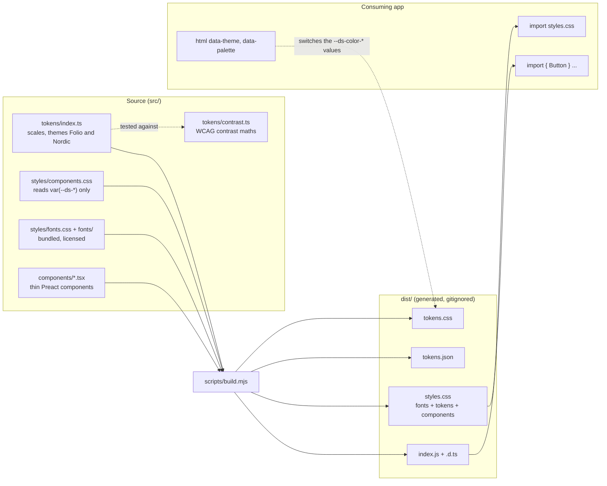

# Architecture

Leoforma has three layers. Tokens are the single source of design decisions, a stylesheet and a set of thin Preact components read them, and an app consumes the built output. Nothing flows backwards: components never define a raw colour, and tokens know nothing about components.



## Layers

| Layer | Where | Responsibility |
| --- | --- | --- |
| Tokens | `src/tokens/index.ts` | Spacing, radius, type, motion, z-index scales and semantic colour roles per theme and mode. Plain TypeScript objects. |
| Primitives | `src/components/overlayStack.ts`, `rovingKeys.ts`, `cx.ts` | Shared behaviour without markup: who is the topmost overlay, scroll lock reference counting, roving keyboard focus. |
| Components | `src/components/*.tsx` | Accessible markup and behaviour. They set class names (`ds-*`) and ARIA state, nothing visual. |
| Styles | `src/styles/*.css` | Visual rules written against `var(--ds-*)`. No literal colours. |

Components read colour roles (`--ds-color-accent`, `--ds-color-surface`), never palette values, so a theme is a different set of values behind the same role names.

## Build outputs

`npm run build` (`scripts/build.mjs`) compiles with `tsc`, then generates the tokens from the compiled module:

| File | Content |
| --- | --- |
| `dist/index.js`, `index.d.ts` | Components, token objects and contrast helpers as native ESM with types. |
| `dist/tokens.css` | Custom properties, prefixed `--ds-`. Generated, never edited. |
| `dist/tokens.json` | The same token object as JSON, for tools that cannot read CSS. |
| `dist/fonts.css`, `dist/fonts/` | `@font-face` rules and the font files with their licences. |
| `dist/components.css` | Component rules. |
| `dist/styles.css` | `fonts.css`, `tokens.css` and `components.css` concatenated, in that order. |

`test/build.test.ts` checks that the JSON and CSS come from the same source, that no remote resource is referenced and that `preact` is the only runtime import.

## Theming: mode and palette

Two independent attributes on the root element select the values behind the `--ds-color-*` roles. The generated CSS (see `renderTokensCss` in `scripts/build.mjs`) has one block set per theme:

| Attribute | Values | Absent means |
| --- | --- | --- |
| `data-theme` | `light`, `dark` | Follow the OS through `prefers-color-scheme` |
| `data-palette` | `nordic` | The default theme, Folio |

```css
:root { /* Folio, light */ }
@media (prefers-color-scheme: dark) { :root:not([data-theme="light"]) { /* Folio, dark */ } }
:root[data-theme="dark"] { /* Folio, dark, forced */ }
/* the same three blocks again with [data-palette="nordic"] */
```

Because the switch is a plain attribute and a cascade, an app needs no JavaScript runtime for theming and no component re-renders: `document.documentElement.setAttribute("data-palette", "nordic")` is enough. Under `prefers-reduced-motion: reduce` every `--ds-motion-*` duration collapses to 1ms.

## CSS ordering

There are no CSS `@layer` rules. Order matters instead: `styles.css` is fonts, then tokens, then component rules, so component selectors (single class, `ds-` prefixed, low specificity) can be overridden by an app stylesheet loaded afterwards. Consumers who import the pieces separately should keep that order.

## How an app consumes it

1. Install a release (see [docs/releases.md](docs/releases.md)); `preact` is a peer dependency.
2. Import `@leonardschwier/leoforma/styles.css` once and components from `@leonardschwier/leoforma`.
3. Optionally set `data-theme` and `data-palette` on `<html>`.

The quickstart is in [docs/using-leoforma.md](docs/using-leoforma.md). The reasons behind these choices are recorded in [docs/adr](docs/adr/README.md).
