# Leoforma

*forma*, Latin for shape or form. Leoforma is the shared design system and UI library of the Leo apps (Leotheca, Leoposta and others): design tokens as CSS custom properties and JSON, plus thin, accessible Preact components with two themes, Folio and Nordic. Fonts are bundled (each with its licence), so building and using it needs no network.

## Use it from another repository

Install the built tarball of a release tag. Release tags point at a commit that includes the built `dist/`, so the install needs no build step and works offline from the npm cache, on Windows and in sandboxed packagers. The lockfile pins the tarball integrity:

```sh
npm install --save-exact https://codeload.github.com/LeonardSchwier/leoforma/tar.gz/refs/tags/v0.2.0
```

The release also attaches the packed tarball (`npm pack` output), which is byte-stable for a given tag. Pin its sha512 integrity in the consumer lockfile:

```sh
npm install --save-exact https://github.com/LeonardSchwier/leoforma/releases/download/v0.2.0/leonardschwier-leoforma-0.2.0.tgz
```

```ts
import { Button } from "@leonardschwier/leoforma";
import "@leonardschwier/leoforma/styles.css"; // tokens, fonts, component styles
```

Other entry points: `/tokens`, `/tokens.json`, `/tokens.css`, `/fonts.css`, `/components.css`. `preact` is a peer dependency. The package is not published to npm.

## Components

Button, IconButton, Spinner, SegmentedControl, Tabs, Menu, Tooltip, Dialog, ToastRegion, form fields, Badge, Card, plus:

- `Sheet`: a modal panel anchored to the bottom edge. It wraps `Dialog`, so it shares focus trapping, Escape and backdrop dismissal, scroll lock and overlay stacking, and adds a visible close button (`showCloseButton`, label `closeLabel`).
- `EmptyState`: a labelled region with title, description, decorative icon and at most one `primaryAction` and one `secondaryAction`; `size` is `sm` or `md`.
- `StatusIndicator`: short status text with variant `neutral`, `progress`, `success`, `warning` or `danger`. The text is always shown. `live` is `off`, `polite` (role status) or `assertive` (role alert).
- `Icon` and `ICON_NAMES`: a typed set of 28 inline SVG icons on a 24 by 24 canvas that follow `currentColor`. An icon is `aria-hidden` unless it gets a `title`, which makes it an image with that name.

### Gallery

Screenshots are generated from the repository's own gallery page (`site/`) with Playwright, using fictional content: `npm run screenshots`.

| Component | Light | Dark |
| --- | --- | --- |
| Button | 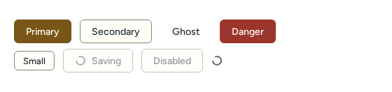 | 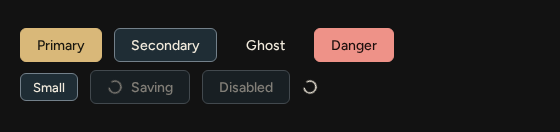 |
| IconButton |  | 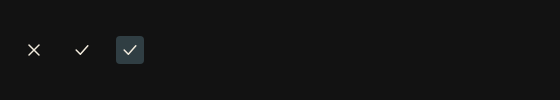 |
| Icon set | 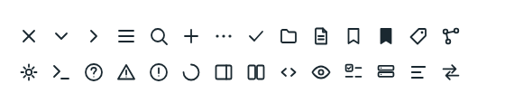 | 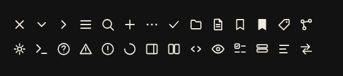 |
| Badge | 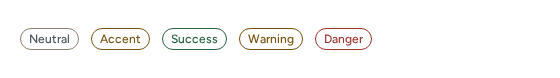 | 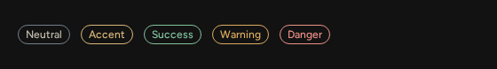 |
| StatusIndicator |  | 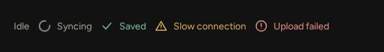 |
| Card | 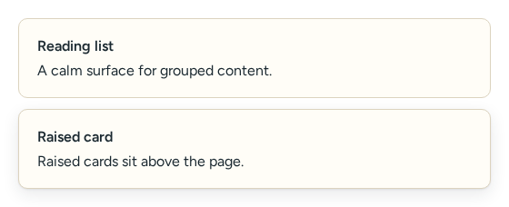 | 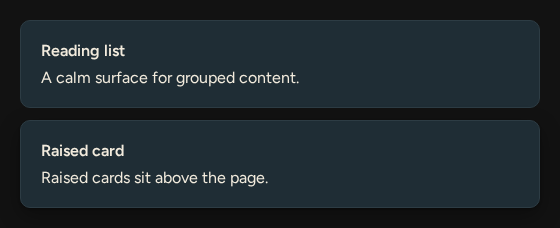 |
| EmptyState | 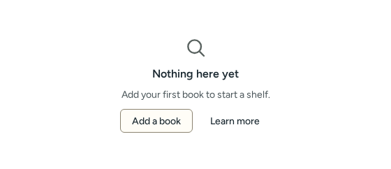 | 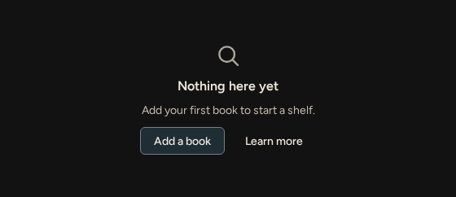 |
| Form fields (Input, Textarea, Select, Checkbox, Switch) | 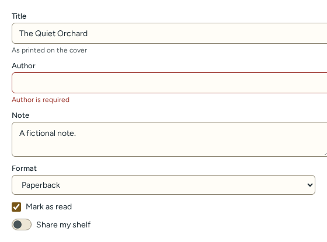 | 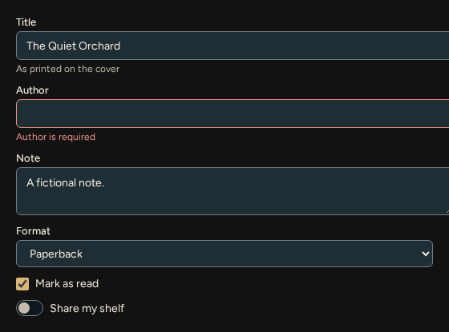 |
| Tabs | 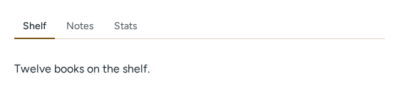 | 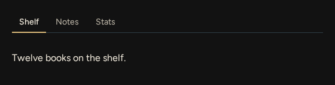 |
| SegmentedControl | 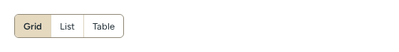 | 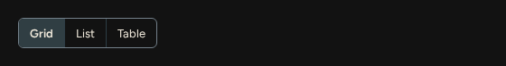 |
| Dialog | 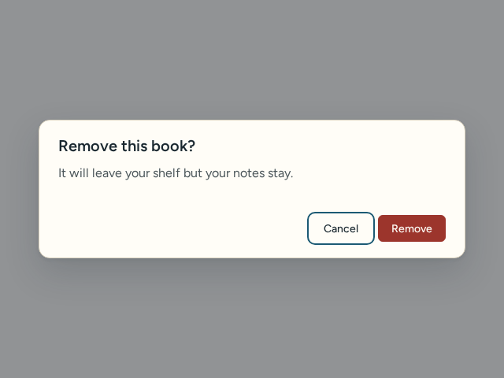 | 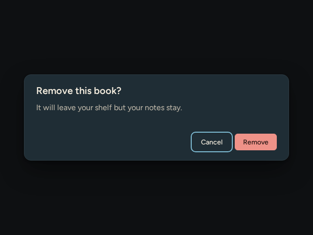 |
| Sheet | 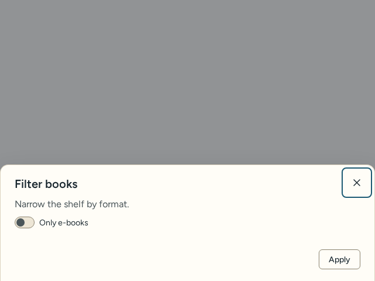 | 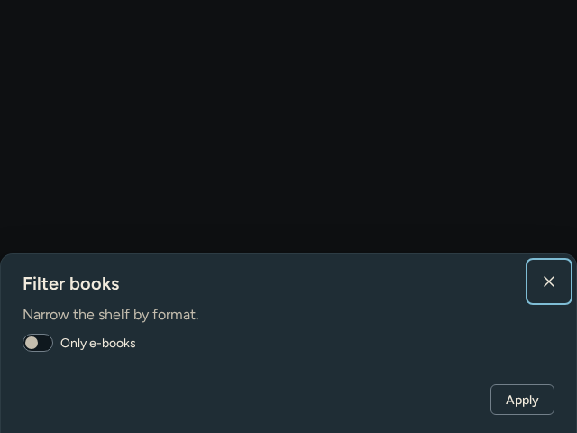 |
| Menu | 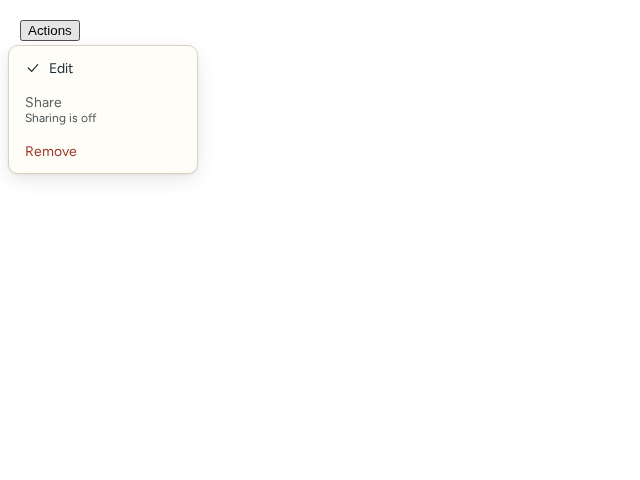 | 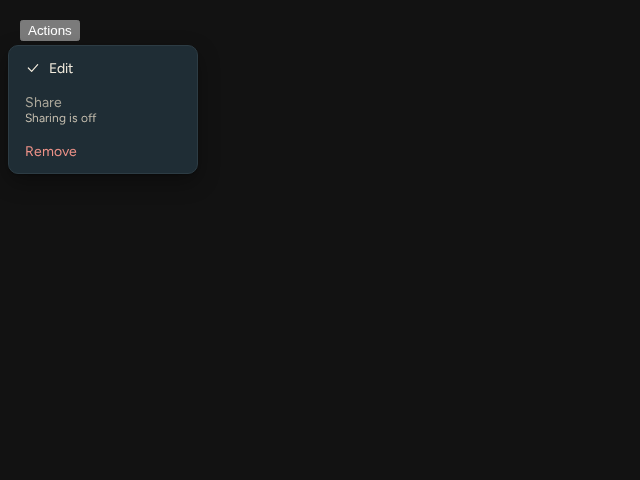 |
| Tooltip |  | 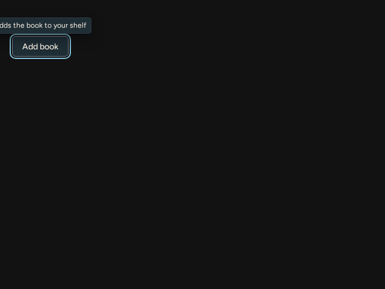 |
| ToastRegion | 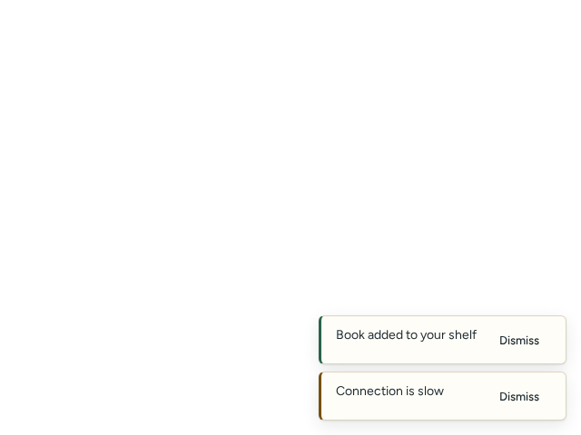 | 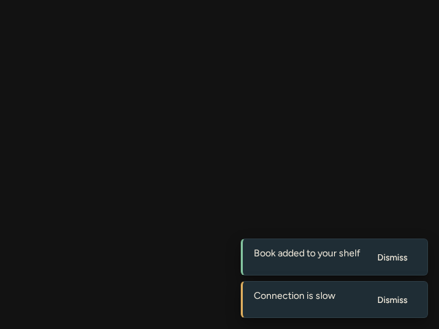 |

## Accessibility

Every component has a vitest test and an axe-core check (`test/axeCheck.ts`, used throughout `test/components.test.tsx`). axe cannot judge colour contrast in jsdom, so `test/contrast.test.ts` checks every text, accent and focus colour pair of both themes in light and dark against WCAG 2.1 AA (4.5 for text, 3 for focus rings and control borders). Overlays trap focus and respect Escape and stacking; motion collapses under `prefers-reduced-motion`.

## Design tokens

Tokens live in `src/tokens/index.ts` and are the single source for `tokens.css` (CSS custom properties, prefixed `--ds-`) and `tokens.json`. Select the mode with `data-theme="light|dark"` (absent follows the OS) and the theme with `data-palette="nordic"` (absent is Folio). `test/build.test.ts` checks that both formats come from the same source.

## Versioning and releases

Semver, with the breaking-change rule for 0.x in `CONTRIBUTING.md`. Changes are listed in `CHANGELOG.md`. A release is a `vX.Y.Z` tag on a commit that includes the built `dist/`, plus the `npm pack` tarball attached to the GitHub release; consumers pin its sha512 integrity in their lockfile. The steps are in `CONTRIBUTING.md`.

## Dependencies and security

CI audits runtime dependencies (`npm audit --omit=dev`; there are none besides the `preact` peer). `npm audit` over the dev toolchain currently reports moderate advisories in vitest and minimatch; they affect only local test and lint runs, never the published output, and the fixes need a major vitest upgrade. Dependabot proposes npm and GitHub Actions updates monthly. See `SECURITY.md` to report a vulnerability and `CONTRIBUTING.md` to contribute.

## Why this repository is best practice

- Behaviour is specified by tests, not prose: 257 vitest tests cover every component ([`test/components.test.tsx`](test/components.test.tsx)).
- Accessibility is enforced, not promised: each component runs through axe-core ([`test/axeCheck.ts`](test/axeCheck.ts)).
- Colour contrast is a failing test, so a token change cannot silently break WCAG AA ([`test/contrast.test.ts`](test/contrast.test.ts)).
- One source of truth for design decisions: CSS and JSON tokens are generated from one module ([`src/tokens/index.ts`](src/tokens/index.ts), [`scripts/build.mjs`](scripts/build.mjs)).
- The build output is verified, not trusted ([`test/build.test.ts`](test/build.test.ts)).
- Every change passes the same gate locally and in CI: typecheck, lint, tests, build ([`.github/workflows/ci.yml`](.github/workflows/ci.yml)).
- Types are strict, so consumers get precise props ([`tsconfig.json`](tsconfig.json)).
- Releases are reproducible and tamper-evident: tagged commits ship `dist/`, with a tarball whose integrity hash consumers pin ([`CONTRIBUTING.md`](CONTRIBUTING.md), [`CHANGELOG.md`](CHANGELOG.md)).
- Dependencies stay small and fresh: a peer dependency only at runtime, monthly Dependabot ([`.github/dependabot.yml`](.github/dependabot.yml)).
- Visual documentation cannot rot: screenshots are regenerated by a script ([`scripts/screenshots.mjs`](scripts/screenshots.mjs)).
- Fonts and assets carry their licences ([`src/fonts`](src/fonts)), and the library itself is MIT ([`LICENSE`](LICENSE)).
- Ownership and process are explicit ([`.github/CODEOWNERS`](.github/CODEOWNERS), [`.github/pull_request_template.md`](.github/pull_request_template.md), [`SECURITY.md`](SECURITY.md)).

## Develop

```sh
npm ci
npm run check        # tsc, eslint, vitest, build
npm run screenshots  # regenerate docs/screenshots
```

`npm run build` writes `dist/` (gitignored): `index.js` and types, `tokens.css`, `tokens.json`, `fonts.css`, `components.css`, `styles.css`, and the font files with their licences. `npm install` from a git branch or commit runs the build through the `prepare` script; release tags (v0.1.1 and later) ship `dist/` instead, committed only on the tagged commit, never on main.

## Rules

- Tokens and components change here first; apps consume a tagged release. Do not fork component code into an app.
- Every component needs a test and an axe accessibility check. Contrast ratios are tested (WCAG AA).
- New fonts, icons or images need a licence file in `src/fonts` or next to the asset before they are merged.
- Licence: MIT (see `LICENSE`); fonts keep their own open licences.
