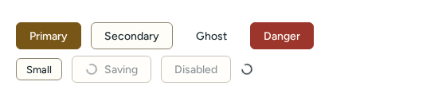
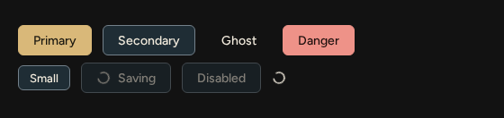
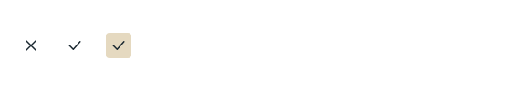
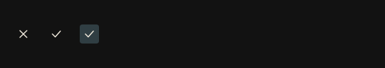

# Actions

Source: [`Button.tsx`](../../src/components/Button.tsx), [`IconButton.tsx`](../../src/components/IconButton.tsx), [`Spinner.tsx`](../../src/components/Spinner.tsx).

| Light | Dark |
| --- | --- |
|  |  |
|  |  |

## Button

Variants `primary`, `secondary`, `ghost`, `danger`; sizes `sm`, `md`. Also accepts native `<button>` attributes.

<!-- props:ButtonProps -->
| Prop | Type | Required | Notes |
| --- | --- | --- | --- |
| `variant` | `ButtonVariant` | no |  |
| `size` | `ButtonSize` | no |  |
| `loading` | `boolean` | no | Shows a spinner and blocks activation. The label stays in the DOM so the accessible name does not change while busy, and the button stays focusable (`aria-disabled`, not `disabled`), so a keyboard user who pressed it keeps their place. A host `disabled` still disables it natively, and then focus is lost as before: do not pass `disabled` together with `loading`. |
| `children` | `ComponentChildren` | yes |  |
<!-- /props -->

Accessibility: renders a native `button`. While `loading` the label stays in the DOM, so the accessible name does not change, `aria-busy` is set, and the button is exposed as unavailable (`aria-disabled="true"`) but stays focusable. A natively `disabled` button loses focus (to the page body in Chromium), so a keyboard or screen reader user who pressed "Save" would lose their place; here focus stays and the activation (click, Enter, Space, a form submit or reset) is ignored and kept from reaching ancestors. A `disabled` prop still sets native `disabled`, and then focus is lost as before, so do not pass `disabled` along with `loading`: `loading` alone already blocks activation. The spinner is decorative: nothing announces completion, so a host should announce the outcome itself (for example in a status region or `ToastRegion`). Hover, focus and key events other than the click still reach the host's handlers while loading.

## IconButton

An icon-only button. Also accepts native button attributes.

<!-- props:IconButtonProps -->
| Prop | Type | Required | Notes |
| --- | --- | --- | --- |
| `icon` | `ComponentChildren` | yes | The glyph, for example an `Icon`. |
| `label` | `string` | yes | Required: an icon alone gives assistive technology nothing to announce. Also used as the native tooltip. |
| `size` | `IconButtonSize` | no |  |
| `active` | `boolean` | no | Makes this a toggle button and exposes its state through `aria-pressed`. Leave it out for an ordinary action: passing nothing renders no `aria-pressed`, so a screen reader does not announce a toggle. |
| `loading` | `boolean` | no | Replaces the glyph with a spinner and blocks activation. The button stays focusable (`aria-disabled`, not `disabled`), so a keyboard user who pressed it keeps their place. A host `disabled` still disables it natively, and then focus is lost as before: do not pass `disabled` together with `loading`. |
<!-- /props -->

Accessibility: `label` is required and becomes `aria-label`. While `loading` it behaves like `Button`: focusable, `aria-busy` and `aria-disabled="true"`, activation ignored. `active` makes the button a toggle and exposes its state through `aria-pressed`; leave it out for an ordinary action and no `aria-pressed` is rendered, so a screen reader does not announce a toggle. Pass an explicit boolean for a real toggle, `active={false}` included.

## Spinner

<!-- props:SpinnerProps -->
| Prop | Type | Required | Notes |
| --- | --- | --- | --- |
| `size` | `number` | no |  |
| `label` | `string` | no | Announced text. Without it the spinner is decorative, for cases where a surrounding control already says that it is busy. |
| `className` | `string` | no |  |
<!-- /props -->

Accessibility: decorative (`aria-hidden`) without a `label`; with one it is a `status` with that name.
