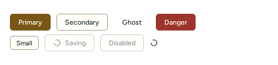
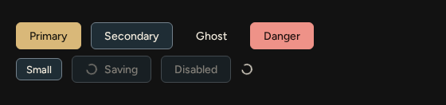
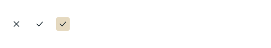
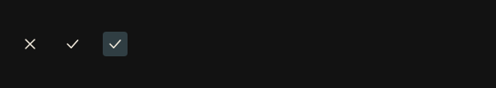

# Actions

Source: [`Button.tsx`](../../src/components/Button.tsx), [`IconButton.tsx`](../../src/components/IconButton.tsx), [`Spinner.tsx`](../../src/components/Spinner.tsx).

| Light | Dark |
| --- | --- |
|  |  |
|  |  |

## Button

Variants `primary`, `secondary`, `ghost`, `danger`; sizes `sm`, `md`. Also accepts native `<button>` attributes.

<!-- props:ButtonProps -->
| Prop | Type | Required | Notes |
| --- | --- | --- | --- |
| `variant` | `ButtonVariant` | no |  |
| `size` | `ButtonSize` | no |  |
| `loading` | `boolean` | no | Shows a spinner and blocks activation. The label stays in the DOM so the accessible name does not change while busy. |
| `children` | `ComponentChildren` | yes |  |
<!-- /props -->

Accessibility: renders a native `button`. While `loading` the label stays in the DOM, so the accessible name does not change, and `aria-busy` is set.

## IconButton

An icon-only button. Also accepts native button attributes.

<!-- props:IconButtonProps -->
| Prop | Type | Required | Notes |
| --- | --- | --- | --- |
| `icon` | `ComponentChildren` | yes | The glyph, for example an `Icon`. |
| `label` | `string` | yes | Required: an icon alone gives assistive technology nothing to announce. Also used as the native tooltip. |
| `size` | `IconButtonSize` | no |  |
| `active` | `boolean` | no | Exposes a toggle's on state through `aria-pressed`. |
| `loading` | `boolean` | no |  |
<!-- /props -->

Accessibility: `label` is required and becomes `aria-label`; `active` exposes a toggle state through `aria-pressed`.

## Spinner

<!-- props:SpinnerProps -->
| Prop | Type | Required | Notes |
| --- | --- | --- | --- |
| `size` | `number` | no |  |
| `label` | `string` | no | Announced text. Without it the spinner is decorative, for cases where a surrounding control already says that it is busy. |
| `className` | `string` | no |  |
<!-- /props -->

Accessibility: decorative (`aria-hidden`) without a `label`; with one it is a `status` with that name.
