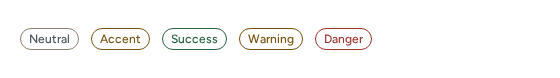
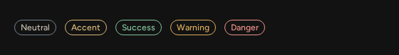
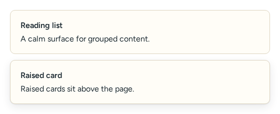
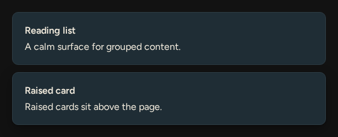
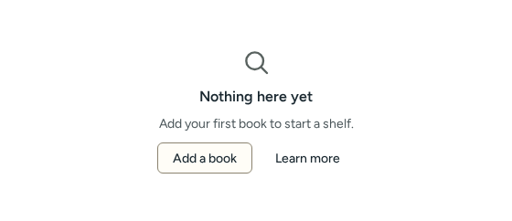
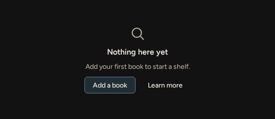
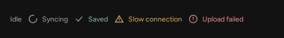

# Feedback and surfaces

Source: [`surfaces.tsx`](../../src/components/surfaces.tsx), [`StatusIndicator.tsx`](../../src/components/StatusIndicator.tsx).

| Component | Light | Dark |
| --- | --- | --- |
| Badge |  |  |
| Card |  |  |
| EmptyState |  |  |
| StatusIndicator |  |  |

## Badge

Also accepts native `span` attributes.

<!-- props:BadgeProps -->
| Prop | Type | Required | Notes |
| --- | --- | --- | --- |
| `tone` | `BadgeTone` | no |  |
| `children` | `ComponentChildren` | yes |  |
<!-- /props -->

## Card

Also accepts native element attributes except `title`.

<!-- props:CardProps -->
| Prop | Type | Required | Notes |
| --- | --- | --- | --- |
| `title` | `ComponentChildren` | no |  |
| `raised` | `boolean` | no | Adds the low shadow. Off by default: a border is enough for most cards. |
| `children` | `ComponentChildren` | no |  |
<!-- /props -->

## EmptyState

A labelled region with at most one primary and one secondary action.

<!-- props:EmptyStateProps -->
| Prop | Type | Required | Notes |
| --- | --- | --- | --- |
| `title` | `ComponentChildren` | yes |  |
| `description` | `ComponentChildren` | no |  |
| `icon` | `ComponentChildren` | no | Decorative glyph, hidden from assistive technology. |
| `actions` | `ComponentChildren` | no | Free-form actions. Prefer the two bounded slots below. |
| `primaryAction` | `ComponentChildren` | no | At most one primary and one secondary action keep the hierarchy clear. |
| `secondaryAction` | `ComponentChildren` | no |  |
| `size` | `EmptyStateSize` | no |  |
| `className` | `string` | no |  |
<!-- /props -->

Accessibility: `aria-labelledby` the title and `aria-describedby` the description; the icon is `aria-hidden`.

## StatusIndicator

<!-- props:StatusIndicatorProps -->
| Prop | Type | Required | Notes |
| --- | --- | --- | --- |
| `children` | `ComponentChildren` | yes |  |
| `variant` | `StatusIndicatorVariant` | no |  |
| `size` | `StatusIndicatorSize` | no |  |
| `live` | `StatusIndicatorLive` | no | Makes changes to the text announced: "polite" as a status, "assertive" as an alert. |
| `icon` | `IconName \| false` | no | Overrides the variant's icon; `false` shows none. |
| `title` | `string` | no |  |
| `className` | `string` | no |  |
<!-- /props -->

Accessibility: the text is always visible, so state is never colour alone. `live="polite"` sets `role="status"`, `live="assertive"` sets `role="alert"`, `off` sets no role. The `progress` variant sets `aria-busy`.
