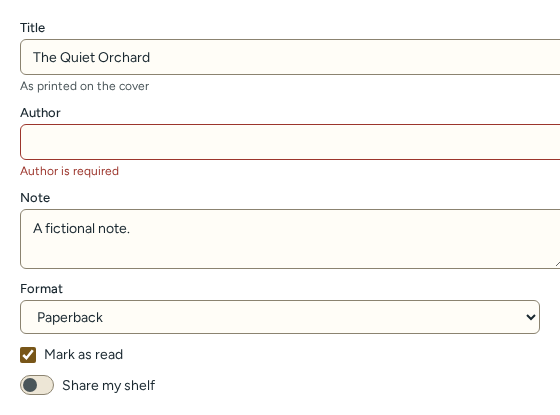
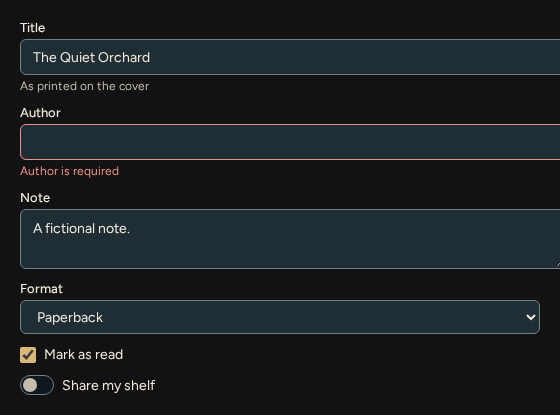

# Form fields

Source: [`fields.tsx`](../../src/components/fields.tsx).

| Light | Dark |
| --- | --- |
|  |  |

`Input`, `Textarea` and `Select` share the field props below and also accept the native attributes of `input`, `textarea` and `select`. `Checkbox` and `Switch` take a `label` and native checkbox attributes.

<!-- props:InputProps -->
| Prop | Type | Required | Notes |
| --- | --- | --- | --- |
| `label` | `string` | yes | Visible label, associated with the control through `for`. |
| `hint` | `ComponentChildren` | no |  |
| `error` | `ComponentChildren` | no | Marks the control invalid and connects this text as its description. |
<!-- /props -->

## Select

Adds an options list:

<!-- props:SelectOption -->
| Prop | Type | Required | Notes |
| --- | --- | --- | --- |
| `value` | `string` | yes |  |
| `label` | `string` | yes |  |
| `disabled` | `boolean` | no |  |
<!-- /props -->

Accessibility: the visible `label` is tied to the control with `for`; `hint` and `error` are connected through `aria-describedby`; a non-empty `error` sets `aria-invalid="true"`, and without one a host-supplied `aria-invalid` is kept. Ids are generated unless you pass `id`. `Switch` is a native checkbox with `role="switch"`, so Space and form submission behave natively.
