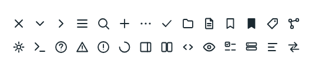
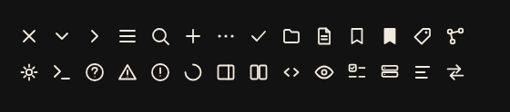

# Icons

Source: [`icons.tsx`](../../src/components/icons.tsx).

| Light | Dark |
| --- | --- |
|  |  |

`ICON_NAMES` lists the 28 icons; `IconName` is their union type. Icons are inline SVG on a 24 by 24 canvas and follow `currentColor`, so there is no icon font and no network fetch.

<!-- props:IconProps -->
| Prop | Type | Required | Notes |
| --- | --- | --- | --- |
| `name` | `IconName` | yes |  |
| `size` | `number` | no |  |
| `className` | `string` | no |  |
| `title` | `string` | no | Without a title the icon is decorative (`aria-hidden`), for use inside a control that already has a name. With one it becomes an image with that accessible name. |
<!-- /props -->

Accessibility: without `title` an icon is `aria-hidden`, for use inside a control that already has a name. With `title` it is an image with that accessible name.
