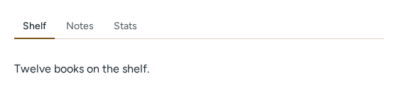
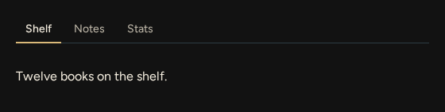
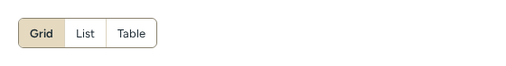
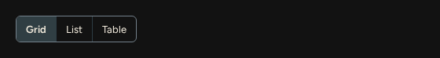
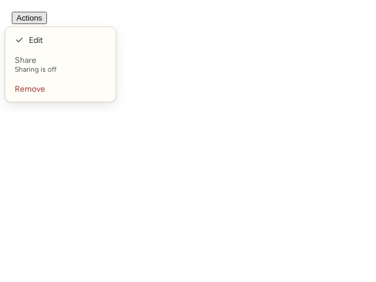
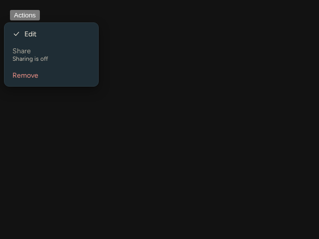

# Navigation

Source: [`Tabs.tsx`](../../src/components/Tabs.tsx), [`SegmentedControl.tsx`](../../src/components/SegmentedControl.tsx), [`Menu.tsx`](../../src/components/Menu.tsx), [`rovingKeys.ts`](../../src/components/rovingKeys.ts).

| Component | Light | Dark |
| --- | --- | --- |
| Tabs |  |  |
| SegmentedControl |  |  |
| Menu |  |  |

## Tabs

Controlled: you own `value`.

<!-- props:TabsProps -->
| Prop | Type | Required | Notes |
| --- | --- | --- | --- |
| `label` | `string` | yes | Accessible name of the tab list. |
| `items` | `readonly TabItem[]` | yes |  |
| `value` | `string` | yes |  |
| `onChange` | `(id: string) => void` | yes |  |
| `className` | `string` | no |  |
<!-- /props -->

Each item:

<!-- props:TabItem -->
| Prop | Type | Required | Notes |
| --- | --- | --- | --- |
| `id` | `string` | yes |  |
| `label` | `ComponentChildren` | yes |  |
| `panel` | `ComponentChildren` | yes |  |
| `disabled` | `boolean` | no |  |
<!-- /props -->

Accessibility: `tablist`, `tab` and `tabpanel` roles with `aria-selected`, `aria-controls` and `aria-labelledby`. Arrow keys, Home and End move focus between enabled tabs. The group has one tab stop: the selected tab, or the first enabled tab when the selected one is disabled, so the tabs stay reachable by keyboard.

## SegmentedControl

<!-- props:SegmentedControlProps -->
| Prop | Type | Required | Notes |
| --- | --- | --- | --- |
| `label` | `string` | yes | Accessible name of the group. |
| `options` | `readonly SegmentedOption<V>[]` | yes |  |
| `value` | `V` | yes |  |
| `onChange` | `(value: V) => void` | yes |  |
| `className` | `string` | no |  |
<!-- /props -->

Each option:

<!-- props:SegmentedOption -->
| Prop | Type | Required | Notes |
| --- | --- | --- | --- |
| `value` | `V` | yes |  |
| `label` | `ComponentChildren` | yes |  |
| `disabled` | `boolean` | no |  |
<!-- /props -->

Accessibility: a `radiogroup` of `radio` buttons named by `label`, with the same roving arrow-key behaviour and single tab stop as tabs (the first enabled option when the value matches nothing or a disabled option).

## Menu

<!-- props:MenuProps -->
| Prop | Type | Required | Notes |
| --- | --- | --- | --- |
| `label` | `string` | yes |  |
| `trigger` | `ComponentChildren` | yes |  |
| `items` | `readonly MenuItem[]` | yes |  |
| `align` | `MenuAlign` | no |  |
| `disabled` | `boolean` | no |  |
| `title` | `string` | no |  |
| `className` | `string` | no |  |
| `triggerClassName` | `string` | no |  |
<!-- /props -->

Each item:

<!-- props:MenuItem -->
| Prop | Type | Required | Notes |
| --- | --- | --- | --- |
| `id` | `string` | yes |  |
| `label` | `string` | yes |  |
| `onSelect` | `() => void` | yes |  |
| `icon` | `ComponentChildren` | no |  |
| `disabled` | `boolean` | no |  |
| `disabledReason` | `string` | no | Says why the item is unavailable, and connects to it for screen readers. |
| `variant` | `MenuItemVariant` | no |  |
<!-- /props -->

Accessibility: the trigger has `aria-haspopup="menu"`, `aria-expanded` and `aria-controls`. ArrowDown or ArrowUp on the trigger opens the menu; inside, arrows, Home and End move between enabled items, Escape closes, Tab closes. A disabled item can explain itself through `disabledReason`, connected with `aria-describedby`. An open menu closes if the menu becomes `disabled` or its `items` become empty.
