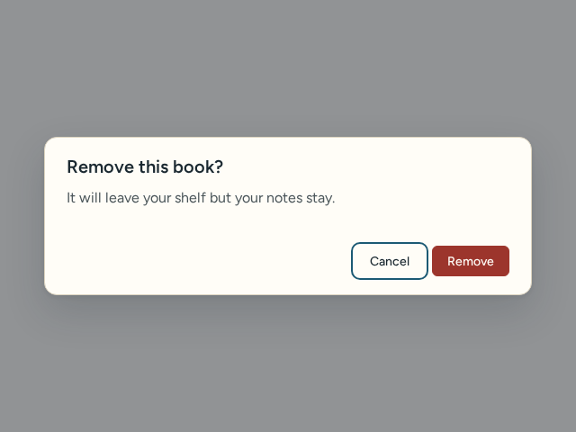
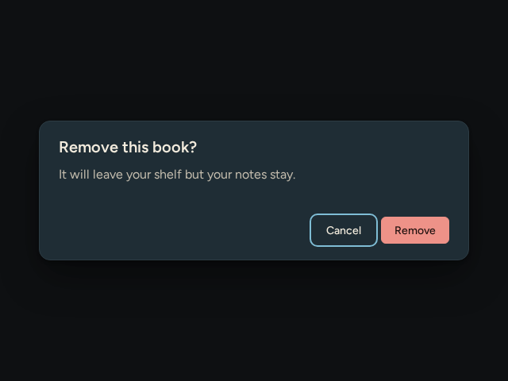
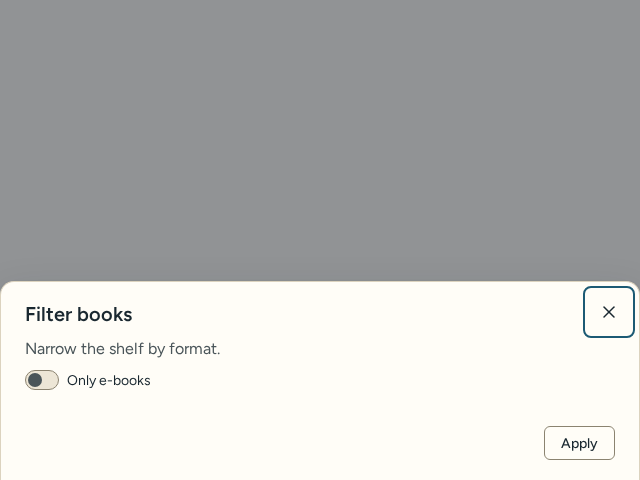
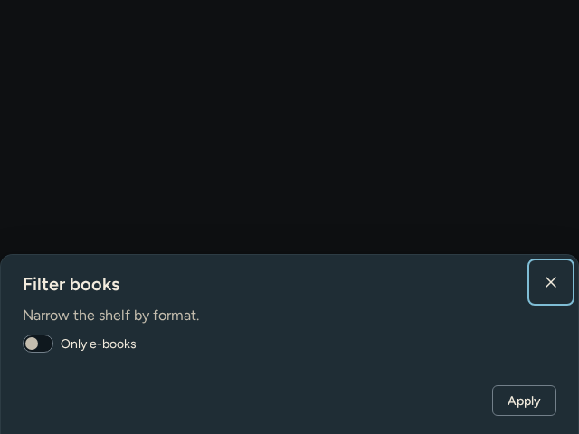
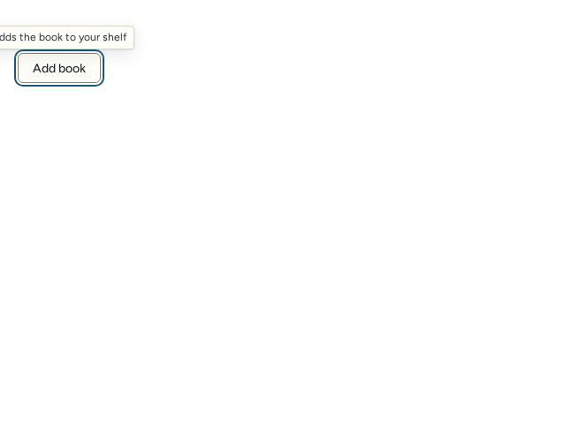
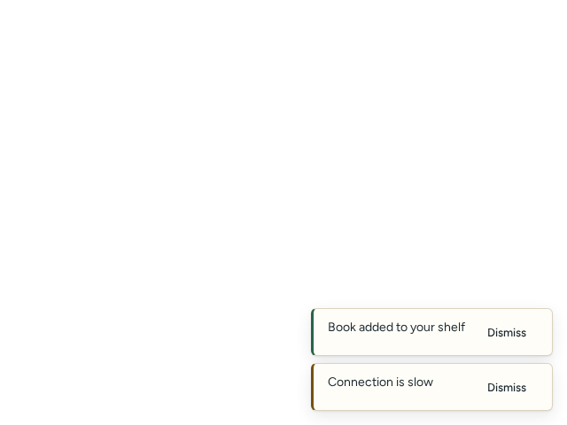
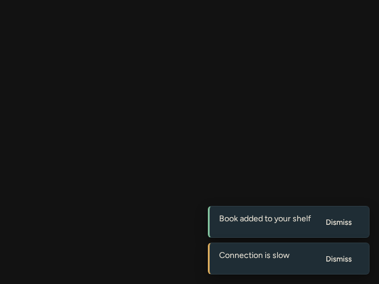

# Overlays

Source: [`Dialog.tsx`](../../src/components/Dialog.tsx), [`Sheet.tsx`](../../src/components/Sheet.tsx), [`Tooltip.tsx`](../../src/components/Tooltip.tsx), [`Toast.tsx`](../../src/components/Toast.tsx), [`overlayStack.ts`](../../src/components/overlayStack.ts).

| Component | Light | Dark |
| --- | --- | --- |
| Dialog |  |  |
| Sheet |  |  |
| Tooltip |  |  |
| ToastRegion |  |  |

## Dialog

Rendered when you render it: the host owns open state and decides what `onDismiss` does. Dismiss reasons are `escape`, `backdrop`, `backbutton` and `close-button`.

<!-- props:DialogProps -->
| Prop | Type | Required | Notes |
| --- | --- | --- | --- |
| `title` | `string` | yes |  |
| `description` | `ComponentChildren` | no |  |
| `children` | `ComponentChildren` | no |  |
| `actions` | `ComponentChildren` | no |  |
| `role` | `DialogRole` | no |  |
| `size` | `DialogSize` | no |  |
| `className` | `string` | no |  |
| `backdropClassName` | `string` | no | Extra class on the backdrop, for host-specific placement. |
| `closeOnEscape` | `boolean` | no |  |
| `closeOnBackdrop` | `boolean` | no |  |
| `restoreFocus` | `boolean` | no |  |
| `initialFocusRef` | `{ current: HTMLElement \| null }` | no |  |
| `onDismiss` | `(reason: DialogDismissReason) => void` | yes |  |
<!-- /props -->

Accessibility: `role` is `dialog` or `alertdialog` with `aria-modal`, named by `title` and described by `description`. Focus moves in before paint (to `initialFocusRef`, else the first focusable element), Tab is trapped among the real tab stops (not `tabindex="-1"` options, hidden inputs, or `hidden`, `inert` and `aria-hidden` subtrees), Escape closes only the topmost overlay (an open `Menu` inside the dialog takes the first Escape, the dialog the next), and focus returns to the previous element unless `restoreFocus` is false. Page scroll is locked while open, reference counted for stacked dialogs. A host with a native back button can call `dismissTopOverlay("backbutton")` and subscribe with `onOverlayPush`.

## Sheet

A bottom-anchored `Dialog` with a visible close button. It shares all Dialog behaviour above.

<!-- props:SheetProps -->
| Prop | Type | Required | Notes |
| --- | --- | --- | --- |
| `title` | `string` | yes |  |
| `description` | `ComponentChildren` | no |  |
| `children` | `ComponentChildren` | no |  |
| `actions` | `ComponentChildren` | no |  |
| `className` | `string` | no |  |
| `closeOnEscape` | `boolean` | no |  |
| `closeOnBackdrop` | `boolean` | no |  |
| `restoreFocus` | `boolean` | no |  |
| `initialFocusRef` | `{ current: HTMLElement \| null }` | no |  |
| `showCloseButton` | `boolean` | no | Default true. A sheet is often used on touch screens where hover or a keyboard is not available, so it ships a visible close control. |
| `closeLabel` | `string` | no | Accessible name of the close control; translate it in a localized host. |
| `onDismiss` | `(reason: SheetDismissReason) => void` | yes |  |
<!-- /props -->

## Tooltip

Supplementary description only, for a single focusable child.

<!-- props:TooltipProps -->
| Prop | Type | Required | Notes |
| --- | --- | --- | --- |
| `content` | `string` | yes |  |
| `placement` | `TooltipPlacement` | no |  |
| `delay` | `number` | no | Hover delay in ms. Keyboard focus shows it at once, since a keyboard user has no pointer path that could trigger it by accident. |
| `disabled` | `boolean` | no |  |
| `children` | `VNode<TriggerProps>` | yes | A single focusable element. |
<!-- /props -->

Accessibility: connected through `aria-describedby` while visible; shows at once on keyboard focus, after `delay` on hover; Escape dismisses it (WCAG 1.4.13). Never put essential information only in a tooltip.

## ToastRegion

<!-- props:ToastRegionProps -->
| Prop | Type | Required | Notes |
| --- | --- | --- | --- |
| `toasts` | `readonly ToastItem[]` | yes |  |
| `onDismiss` | `(id: string) => void` | yes |  |
| `label` | `string` | no | Accessible name of the landmark. |
| `dismissLabel` | `string` | no |  |
<!-- /props -->

Each toast:

<!-- props:ToastItem -->
| Prop | Type | Required | Notes |
| --- | --- | --- | --- |
| `id` | `string` | yes |  |
| `message` | `ComponentChildren` | yes |  |
| `tone` | `ToastTone` | no |  |
| `duration` | `number` | no | Auto dismiss delay in ms. Omit for a toast that stays until closed, which is the right choice for anything the user must not miss. |
<!-- /props -->

Accessibility: a labelled `region` landmark. Danger toasts use `role="alert"`, the others `role="status"`. Omit `duration` for messages the user must not miss.
